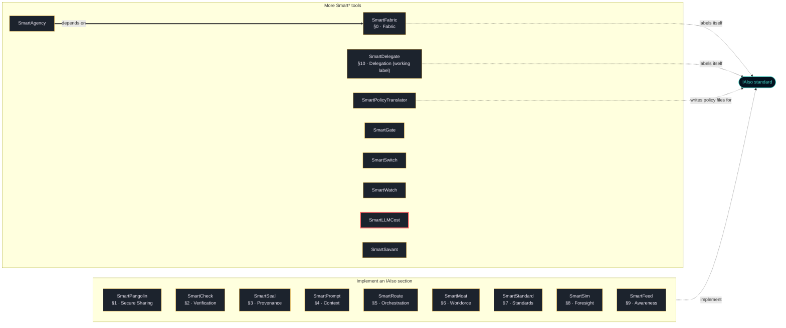

# SmartLLMCost

**The live true-cost calculator for LLMs — apples-to-apples cost & performance.**

What does a model *actually* cost to do your job? SmartLLMCost runs identical task-packs across any model and reports **dollars per _successful_ task** (counting failed attempts), with consistent latency, throughput, and token accounting. Runs identical task-packs across
any model and reports the number that actually matters: **dollars per _successful_ task**,
alongside latency percentiles, throughput, and tokens/sec — reproducibly.

## Why
Per-token price doesn't predict the bill (tokenizers differ per model), latency is
reported inconsistently, and a cheap model that fails a task isn't cheap. SmartLLMCost
measures time and tokens the same way for every model and pairs cost with success.

## Install

```bash
python -m pip install sf-smartllmcost
sf-smartllmcost presets
```

Every file of `sf-smartllmcost` on PyPI is built and published by this repository's release
workflow (`.github/workflows/release.yml`, PyPI trusted publishing) and carries a
provenance attestation that names this repository and that workflow; PyPI shows
it under "Verified details". The same workflow records a GitHub attestation for
the same files, which you can check with
`gh attestation verify <file> --repo SmartTasksOrg/sf-smartllmcost`. A release file without
that provenance is not ours, and neither is a package called `smartllmcost` (without
`sf-`) on any registry.

Version 0.1.0 (published 2026-10-09) is the first release under this name.

To install from a clone instead (Python 3.9 or later):

```bash
git clone https://github.com/SmartTasksOrg/sf-smartllmcost
cd sf-smartllmcost
python -m venv .venv
. .venv/bin/activate          # Windows PowerShell: .\.venv\Scripts\Activate.ps1
python -m pip install .
sf-smartllmcost presets
```

## Status

- **Version 0.1.0, experimental.** A command-line benchmark that measures cost per successful task across LLM providers, with 31 unit tests.
- **Published:** PyPI `sf-smartllmcost` (see Install). Nothing else is published.
- **Tested:** the 31 tests in `tests/` on Python 3.12, Linux, on every push to master and every pull request (`.github/workflows/ci.yml`). The tests make no calls to provider APIs.
- **Not tested:** Windows and macOS; the provider adapters against live provider APIs; Python versions other than 3.12.
- **Ports:** The Go port in `ports/go` has its own tests (`go test ./...`, run by hand, not in CI); the other ports in `ports/` have no automated check against the Python reference. None is published on a registry.
- **Security review:** none independent. Report vulnerabilities as described in [SECURITY.md](SECURITY.md).

## Quickstart
After installing (above):

```bash
# run your own task-pack against a model
sf-smartllmcost run examples/example-taskpack.json --preset openai --model gpt-4o --stream -o report.json  # --stream measures real TTFT
# self-hosted (LM Studio / vLLM / Ollama / llama.cpp)
sf-smartllmcost run taskpack.json --preset lmstudio --model gpt-oss --host 192.168.1.10 --port 1234 \
  --self-hosted-gpu-hour 0.96 -o local.json
# check a task-pack before a long run; list providers
sf-smartllmcost validate taskpack.json
sf-smartllmcost presets
# compare several runs, cheapest-$/success first
sf-smartllmcost compare report.json local.json --format table
# build a traffic-light dashboard from run reports
sf-smartllmcost dashboard report.json local.json --max-cost 0.05 -o dashboard.html
# build a defensible $/GPU-hour for self-hosted cost
sf-smartllmcost gpu-hour --capex 20000 --watts 700 --pue 1.5 --kwh-price 0.12
```

## What it measures
`$ per successful task` · `$ per 1k successful` · success rate · latency p50/p95/p99 ·
output tokens/sec · throughput · native input/output tokens · failure breakdown
(budget-exhaustion vs wrong-answer vs harness-error).

## Structure
- `src/sf_smartllmcost/` — measurement core, pricing, provider adapters, harness runner, CLI.
- `ports/` — Node + Go reimplementations of the core (identical results).
- `integrations/` — an example GitHub Actions workflow (`integrations/github-action/cost-gate.example.yml`), langchain/n8n/flowise, Prometheus export.
- `examples/` — a runnable task-pack.
- Docs: `docs/METHODOLOGY.md`.

## Providers
OpenAI-compatible (OpenAI, LM Studio, vLLM, Ollama, llama.cpp) + Anthropic, via presets. Both support `--stream` for real TTFT.

## Harnesses
Native task-pack format (your own jobs) today; adapters for lm-evaluation-harness / HELM /
SWE-bench convert their tasks into the same shape so the cost/timing math is identical.

Apache-2.0.

## Part of the Smart* family

<!-- smart-family:start -->
<!-- generated by fleet-docs from family.json; change family.json, not this block -->

18 open-source tools by SmartTasks Lab, each standalone, plus the [IAIso standard](https://github.com/SmartTasksOrg/IAISO). Every tool is on PyPI under its `sf-` name; a package without the `sf-` prefix is not ours.

| Tool | IAIso | What it does |
|---|---|---|
| [SmartPangolin](https://github.com/SmartTasksOrg/sf-smartpangolin) | §1 · Secure Sharing | Scan before you share. Stop leaking secrets into AI models, agents, and tools. |
| [SmartCheck](https://github.com/SmartTasksOrg/sf-smartcheck) | §2 · Verification | Check before you sign off. Catch the AI when it's confidently wrong. |
| [SmartSeal](https://github.com/SmartTasksOrg/sf-smartseal) | §3 · Provenance | Seal what you ship. A signed receipt so anyone can verify what they received. |
| [SmartPrompt](https://github.com/SmartTasksOrg/sf-smartprompt) | §4 · Context | Lint before you send. Bad prompt in, bad work out — and it's your name on it. |
| [SmartRoute](https://github.com/SmartTasksOrg/sf-smartroute) | §5 · Orchestration | Route only what you trust. Gate agents and tools with trust scores and guardrails. |
| [SmartMoat](https://github.com/SmartTasksOrg/sf-smartmoat) | §6 · Workforce | Know your moat. Score the tasks AI can't easily take — and widen them. |
| [SmartStandard](https://github.com/SmartTasksOrg/sf-smartstandard) | §7 · Standards | Standardize before you scale. One shared, auditable convention for AI-assisted work. |
| [SmartSim](https://github.com/SmartTasksOrg/sf-smartsim) | §8 · Foresight | Simulate before it hits you. See your role's task-by-task collapse sequence. |
| [SmartFeed](https://github.com/SmartTasksOrg/sf-smartfeed) | §9 · Awareness | Distill the firehose. A tight brief of only what moves your work. |
| [SmartFabric](https://github.com/SmartTasksOrg/sf-smartfabric) | §0 · Fabric | IAIso Fabric Protocol (IFP) — carry & enforce IAIso containment across a fleet of governed AI nodes. |
| [SmartDelegate](https://github.com/SmartTasksOrg/sf-smartdelegate) | §10 · Delegation (working label) | Delegate, don't hand over the keys. An agent never holds more than the human's role for the task: IAM for LLM agents. |
| [SmartPolicyTranslator](https://github.com/SmartTasksOrg/sf-smartpolicytranslator) | writes IAIso policy files | Translate natural-language regulation into REAL, schema-conformant IAIso policy files. |
| [SmartAgency](https://github.com/SmartTasksOrg/sf-smartagency) | — | Signed contracts that say what an AI agent may do, a ledger to suspend and revoke them, and a monitor that enforces them on every action, with SmartFabric pressure limits. |
| [SmartGate](https://github.com/SmartTasksOrg/sf-smartgate) | — | Decision friction and a human override for AI agents: score each action, ask a person before risky ones, kill any action or agent with one logged call. |
| [SmartSwitch](https://github.com/SmartTasksOrg/sf-smartswitch) | — | A quorum kill switch for AI agent fleets: no single keyholder can halt the fleet or block a halt; every agent verifies the signatures itself and stops when cut off. |
| [SmartWatch](https://github.com/SmartTasksOrg/sf-smartwatch) | — | Coupling-density monitor for multi-agent systems: measures how densely agents talk to each other, raises graded alerts, and proposes or issues resets before coordination outgrows human oversight. |
| **[SmartLLMCost](https://github.com/SmartTasksOrg/sf-smartllmcost)** (this repository) | — | Apples-to-apples LLM cost & performance benchmark — cost per successful task, reproducible. |
| [SmartSavant](https://github.com/SmartTasksOrg/sf-smartsavant) | — | A model-agnostic design council: stakeholder views and a juror merge per design-sprint phase, schema-checked adapter answers, exports (spec, stories, decision tree, trainset) and audits of council runs before anyone builds or trains from them. |



Thick arrow: the package requires the other one in its `pyproject.toml`. Dashed arrow: what the tool's README states about IAIso. A tool with no thick arrow does not depend on any other family package; each one installs and runs on its own.

<!-- smart-family:end -->
